<p align="center">
  
</p>

<p align="center">
  
  
  
  
</p>

<p align="center">
  <a href="#about">About</a> &nbsp;·&nbsp;
  <a href="#features">Features</a> &nbsp;·&nbsp;
  <a href="#projects-on-show">Projects</a> &nbsp;·&nbsp;
  <a href="#run-it-locally">Run it</a> &nbsp;·&nbsp;
  <a href="#project-structure">Structure</a> &nbsp;·&nbsp;
  <a href="#design-notes">Design</a>
</p>

<p align="center">
  <em>"Large things start small, and every line of code is a piece towards something far greater; perhaps even beautiful."</em>
</p>

<p align="center"></p>

## About

A single-page portfolio for a junior systems developer, written from scratch in plain **HTML, CSS and JavaScript**. There are no frameworks, no build step and no dependencies, just three files and a folder of assets.

The theme is deep space: nebula photography, a crimson-and-orange palette, Orbitron type, and a hazy scan-line overlay across everything. The page introduces who I am, lists my skills, shows the projects I've built so far, and says what I'm learning next.

**Sections:** Home, a short quote, About, Skills, Projects, Currently Learning, Contact.

<p align="center"></p>

## Features

- **Parallax background.** The fixed nebula layer scrolls more slowly than the page, so the sky feels deeper as you move down.
- **Scroll reveals.** Panels fade and slide in as they enter the screen.
- **Typewriter intro.** The hero line types itself out, with a blinking cursor.
- **Scan lines and a sweeping beam.** A fine line overlay covers the page, and a crimson beam sweeps down each section.
- **Screenshot lightbox.** Click any project screenshot to enlarge it, with a caption taken from the image's description.
- **Responsive layout.** The sections wrap on smaller screens, and the navigation collapses into a menu button.
- **Themed details.** A custom scrollbar, self-hosted Orbitron, and a full favicon set.

### How the effects work

| Effect | Where | How |
| --- | --- | --- |
| Parallax background | `script.js` | The background layer is translated at 30% of the scroll distance, and resized on load and on window resize. |
| Scroll reveals | `script.js` | An `IntersectionObserver` adds a `visible` class once 15% of a panel is on screen. CSS does the fade and slide. |
| Typewriter intro | `script.js` + `style.css` | A timer adds one character every 40 ms. The blinking `_` is a CSS pseudo-element. |
| Scan lines | `style.css` | A `repeating-linear-gradient` overlay on the body, plus an animated crimson beam on each section. |
| Lightbox | `script.js` + `style.css` | Clicking a thumbnail copies its image and `alt` text into a full-screen overlay. A click on the backdrop closes it. |
| Mobile menu | `script.js` | The menu button toggles an `open` class on the links, and tapping a link closes it. |

<p align="center"></p>

## Projects on show

### Black Hole Math



A **WPF desktop app** that calculates the Schwarzschild radius, surface gravity, photon sphere radius and more, wrapped in a fully animated sci-fi interface with a starfield and a black hole.

**Built with:** C#, WPF / XAML

### Capri: Math Assistant



A cyberpunk-styled maths tutor chatbot, inspired by Capricorn from Cyberpunk s2, and built to practise Python. Python runs the conversation logic and opens a desktop window with pywebview, while HTML, CSS and JavaScript handle the loading screen, the falling-digits background and the option buttons. It is rule-based, not an AI, although that's something I'd like to explore in future.

**Built with:** Python, pywebview, matplotlib, HTML, CSS, JavaScript

<p align="center"></p>

## Run it locally

There is nothing to install. Pick whichever way suits you:

**1. Open the file.** Double-click `index.html`. If a browser refuses to load the font from a local file, use option 2 or 3 instead.

**2. VS Code Live Server.** Open the folder in VS Code, then press **Go Live** in the status bar.

**3. A local server with Python.** Run this from the project folder, then visit <http://localhost:8080>:

```bash
python -m http.server 8080
```

Option 3 matches the Chrome launch configuration in `.vscode/launch.json`, so you can also debug it from VS Code.

<p align="center"></p>

## Project structure

```
Portfolio/
├── index.html        the whole page: nav, hero, sections, lightbox
├── style.css         palette, layout, animations, responsive rules
├── script.js         parallax, reveals, typewriter, lightbox, mobile menu
├── assets/
│   ├── fonts/        Orbitron (variable), self-hosted
│   ├── images/       nebula photography, project screenshots, banners, favicons
│   └── readme/       the banner and dividers used in this README
└── .vscode/
    └── launch.json   Chrome debug configuration for localhost:8080
```

<p align="center"></p>

## Design notes

**Palette**

| Colour | Hex | Used for |
| --- | --- | --- |
|  | `#ec1857` | Headings, highlights, the scan beam |
|  | `#ff8c1a` | Hover states, card titles, skill tags |
|  | `#fff4d6` | The quote and closing notes |
|  | `#1a0e12` | Panels and the navigation bar |
|  | `#0a0505` | Page background |

**Type.** Headings use [Orbitron](https://github.com/theleagueof/orbitron), loaded from a local copy in `assets/fonts/`. Body text uses Segoe UI.

<p align="center"></p>

## Currently learning

Modern C# features and best practices, JavaScript beyond static sites, more creative and responsive layouts with HTML and CSS, and more advanced Python. Next up: contributing to something meaningful.

## Credits

- Orbitron typeface, under the SIL Open Font License.
- Banner artwork in `assets/readme/` was drawn for this project, with the title text converted to outlines so it looks the same everywhere.
